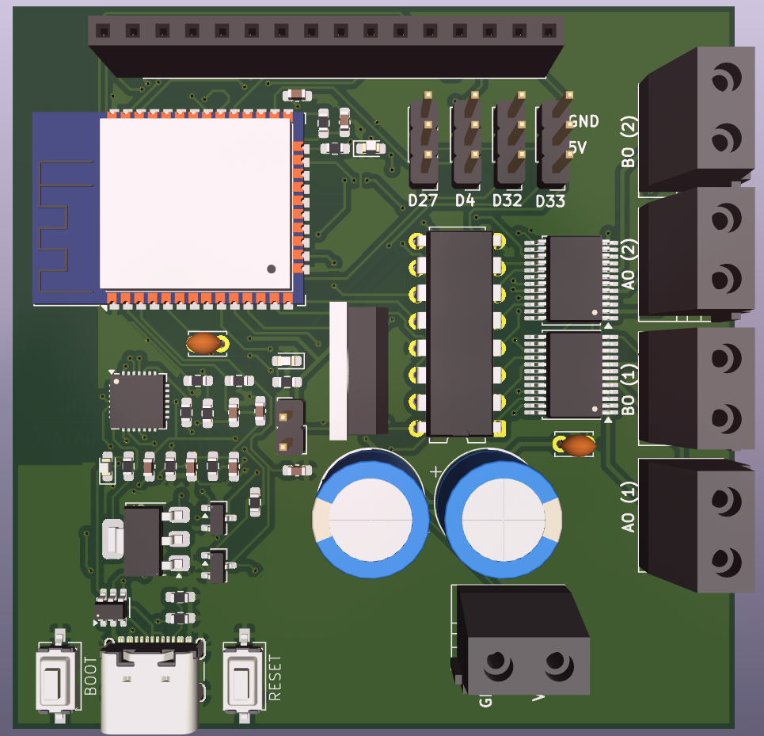
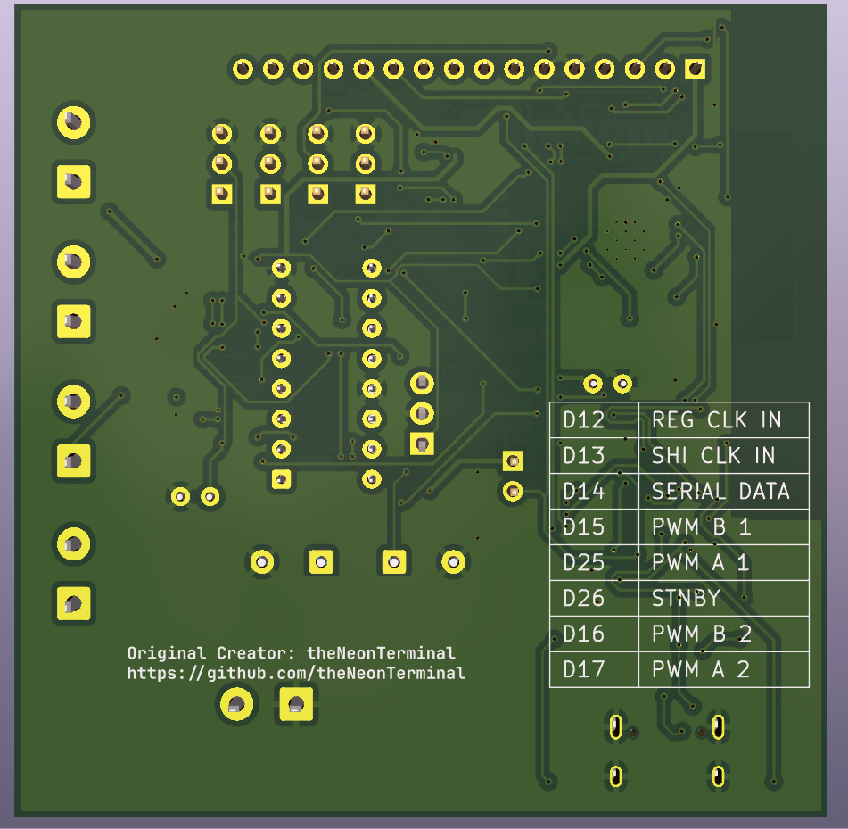
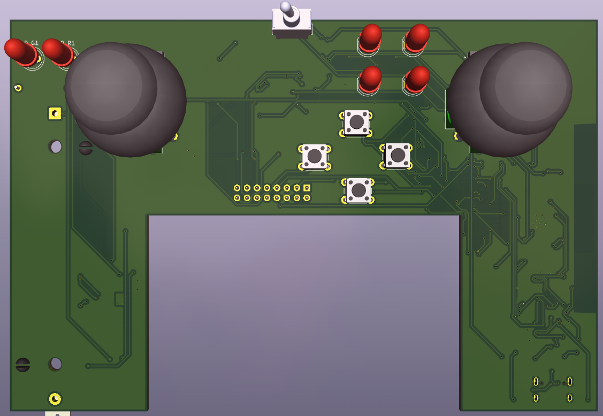
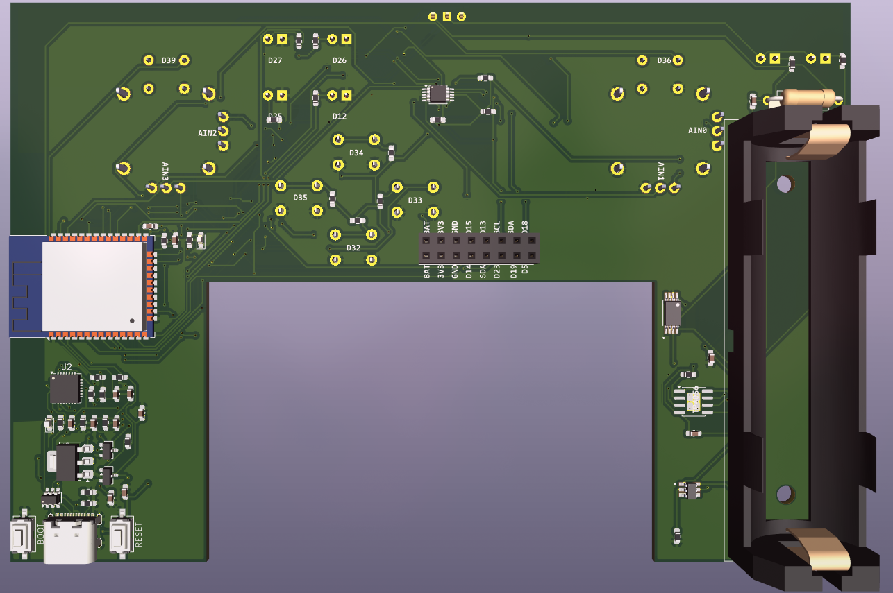

# ESP32 Based RC dev board

A project I made to experiment more with custom ESP32 dev boards and PCBs 100% suited to specific project needs

---

## About this project

This project features 2 PCBs each running its own ESP32 chip. The first board is small in size and is the receiver board - this will go into the device you are trying to control wirelessly. It has an ESP32 Chip (with its PCB Antenna) 2 TB6612FNG Motor drivers, capable of driving upto 4 motors individually in both directions along with PWM speed control, extra headers to attack servos, extra GPIO in the form of header to connects LEDs and other peripherals as needed. The second board contains another ESP32 chip, an ADS1115 ADC connected to 2 joysticks and few push buttons for various other tasks.

From the firmware side, this runs an ESP NOW script allowing seamless and easy wireless control over both. They run a 2 way communication script

> [!NOTE]
> Both boards have a type C port for programming along, the receiver board has an extra 2 pin terminal block for external power to motors, along with a jumper that allows the ESP32 to be powered via external soruce or USB, useful for debugging.

## Hardware Design

### 01 / 3D View

**RX Board**

**TX Board**

> [!NOTE]
> Schematic and footprint PDF availbale in the /ESP_-X_Board/View/

---

## BoM (Bill of Materials)

Also availbale in `./ESP32 RX Board.csv` and `./ESP32 TX Board.csv` if needed in CSV with proper footprints

### ESP32 RX Board

| Reference | Qty | Component / Value | Footprint |
|:---|:---:|:---|:---|
| C1, C2, C8 | 3 | 10µF | `C_0603_1608Metric` |
| C3, C4, C6, C7 | 4 | 0.1µF | `C_0603_1608Metric` |
| C5 | 1 | 4.7µF | `C_0603_1608Metric` |
| C9, C10 | 2 | 10µF (THT) | `CP_Radial_D10.0mm` |
| C11, C_TB1 | 2 | 0.1µF (THT) | `C_Disc_D3.4mm` |
| D1, D2, D3 | 3 | LED (SMD) | `LED_0603_1608Metric` |
| J1 | 1 | USB-C Receptacle | `USB4105-xx-A` |
| J2 | 1 | 2-Pin Header | `PinHeader_1x02` |
| J3 | 1 | 2-Pin Screw Terminal | `MX126-5.0-02P` |
| J4–J7 | 4 | 2-Pin Screw Terminal | `MX126-5.0-02P` |
| J8 | 1 | 16-Pin Socket | `PinSocket_1x16` |
| M1–M4 | 4 | Servo Connector (3-Pin) | `PinHeader_1x03` |
| Q1, Q2 | 2 | SS8050 | `SOT-23` |
| R1, R7 | 2 | 330Ω | `R_0603_1608Metric` |
| R2, R3 | 2 | 5.1kΩ | `R_0603_1608Metric` |
| R4 | 1 | 47.5kΩ | `R_0603_1608Metric` |
| R5 | 1 | 22.1kΩ | `R_0603_1608Metric` |
| R6, R13 | 2 | 1kΩ | `R_0603_1608Metric` |
| R8–R12 | 5 | 10kΩ | `R_0603_1608Metric` |
| SW1 | 1 | Reset Switch | `CK_PTS636Sx25SMTRLFS` |
| SW2 | 1 | Boot Switch | `CK_PTS636Sx25SMTRLFS` |
| U1 | 1 | AMS1117-3.3 | `SOT-223-3` |
| U2 | 1 | CP2102N-Axx-xQFN28 | `QFN-28-1EP` |
| U3 | 1 | USBLC6-2SC6 | `SOT-23-6` |
| U4 | 1 | ESP32-WROOM-32 | `ESP32-WROOM-32` |
| U5 | 1 | L7805 | `TO-220-3` |
| U6, U7 | 2 | TB6612FNG | `SSOP-24` |
| U8 | 1 | 74HC595 | `DIP-16_W7.62mm` |

### ESP32 TX Board

| Reference | Qty | Component / Value | Footprint |
|:---|:---:|:---|:---|
| BT1 | 1 | Battery | `BatteryHolder_MPD_BH-18650-PC` |
| C1, C2, C8, C12 | 4 | 10µF | `C_0603_1608Metric` |
| C3, C4, C6, C7, C9, C10, C11, C13 | 8 | 0.1µF | `C_0603_1608Metric` |
| C5 | 1 | 4.7µF | `C_0603_1608Metric` |
| D2, D5 | 2 | LED (SMD) | `LED_0603_1608Metric` |
| DP1–DP4 | 4 | Push Button | `SW_PUSH_6mm` |
| D_G1, D_R1, L1–L4 | 6 | LED (5mm THT) | `LED_D5.0mm` |
| J1 | 1 | USB-C Receptacle | `USB4105-xx-A` |
| J2 | 1 | 2×8 Pin Socket | `PinSocket_2x08` |
| Q1, Q2 | 2 | SS8050 | `SOT-23` |
| Q3 | 1 | FS8205A | `SOP65P640X120-8N` |
| R1 | 1 | 330Ω | `R_0603_1608Metric` |
| R2, R3 | 2 | 5.1kΩ | `R_0603_1608Metric` |
| R4 | 1 | 47.5kΩ | `R_0603_1608Metric` |
| R5 | 1 | 22.1kΩ | `R_0603_1608Metric` |
| R6, R15–R18, R20–R23 | 9 | 1kΩ | `R_0603_1608Metric` |
| R7–R14 | 8 | 10kΩ | `R_0603_1608Metric` |
| R19 | 1 | 100Ω | `R_Axial_DIN0309` |
| R24–R28 | 5 | 470Ω | `R_0603_1608Metric` |
| SW1 | 1 | Reset Switch | `CK_PTS636Sx25SMTRLFS` |
| SW2 | 1 | Boot Switch | `CK_PTS636Sx25SMTRLFS` |
| SW3 | 1 | SPDT Slide Switch | `WS-SLTV` |
| U1 | 1 | AMS1117-3.3 | `SOT-223-3` |
| U2 | 1 | CP2102N-Axx-xQFN28 | `QFN-28-1EP` |
| U3 | 1 | USBLC6-2SC6 | `SOT-23-6` |
| U4 | 1 | ESP32-WROOM-32 | `ESP32-WROOM-32` |
| U5 | 1 | ADS1115IDGS | `TSSOP-10` |
| U6, U7 | 2 | Joystick Module | `JoyStick` |
| U8 | 1 | TP4056 | `SOIC-8-1EP` |
| U9 | 1 | DW01A | `SOT95P280X145-6N` |
